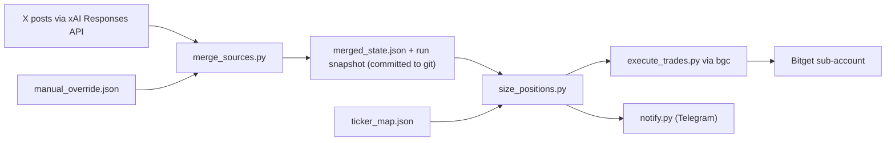

# Portfolio Mirror

Automated pipeline that follows publicly disclosed AI-managed stock portfolios (Grok, Claude, DeepSeek and GPT, run by AI Finance Labs on the Autopilot platform) and mirrors them into isolated tokenised-stock sub-accounts on Bitget. It runs unattended on GitHub Actions.

> [!WARNING]
> This is a personal automation project, not financial advice. It mirrors third parties' disclosed activity with a delay, through an independent execution venue. The repository is configured for **paper trading** (Bitget's demo environment). Anyone running it with real funds is solely responsible for the trades it places and for complying with the laws of their jurisdiction and the terms of every platform involved.

## Why this exists

Autopilot is not available to Nigerian residents, so there was no direct way to follow its disclosed portfolios or automate trades from Nigeria. This project follows the same public disclosures independently and applies them to separate sub-accounts.

## What it does

- Runs **four independent pipelines**, one per portfolio, as parallel GitHub Actions jobs every 6 hours.
- Extracts each portfolio's latest disclosures from X posts through the xAI Responses API and classifies every post as either a **weight disclosure** (auto-traded) or a **narrative action** with no size (Telegram alert only, never traded).
- Reconciles tweet data with a hand-maintained **manual override** file, per ticker, keeping whichever source is fresher.
- Sizes and places rebalancing orders against each portfolio's own Bitget sub-account.
- Runs a **daily ticker-discovery workflow** that finds tickers missing from the mapping and proposes fixes as pull requests.
- Sends a Telegram summary per portfolio and commits a snapshot of every run to git.

## Architecture



### The four portfolios

| Portfolio | Data source | Notes |
|---|---|---|
| `grok` | Live X feed (`@grkportfolio`) + manual override | Original portfolio, unprefixed secret names |
| `claude` | Live X feed (`@theaiportfolios`) + manual override | |
| `gpt` | Manual override only | Its public X account was suspended |
| `deepseek` | Manual override only | Never had a dedicated public feed |

Portfolios without credentials for a sub-account fall back to **tracking-only mode**: targets are fetched, merged and recorded, and a summary is sent, but no trades are sized or placed.

## Repository structure

```
.github/workflows/
  mirror.yml                  Every 6 hours; one parallel job per portfolio
  suggest-ticker-mappings.yml Daily; opens a PR with new ticker mappings
  coverage_recheck.yml        Monthly; Bitget vs MEXC coverage report (informational)

portfolios/<name>/
  portfolio.json              Display name, X handle (or null), secret prefix
  status.json                 {"dry_run": bool, "paper_trading": bool}
  config/manual_override.json Hand-edited positions with an as_of date
  data/merged_state.json      Current reconciled target weights (generated)
  data/snapshots/             History of every run (generated)

config/ticker_map.json        Shared ticker -> Bitget symbol map for all portfolios

scripts/
  main.py                     Orchestrates one portfolio (selected via PORTFOLIO env var)
  fetch_tweets.py             xAI X-search extraction and trade-vs-commentary classification
  merge_sources.py            Per-ticker reconciliation of tweets and manual overrides
  ticker_mapping.py           Symbol lookup and live-market check for candidate mappings
  generate_mapping_suggestions.py  Scans all portfolios for unmapped tickers
  size_positions.py           Target-weight rebalancing maths
  execute_trades.py           Order placement via the Bitget CLI (bgc)
  notify.py                   Telegram summaries
  coverage_recheck.py         Monthly MEXC-vs-Bitget coverage check
  portfolio_config.py         Loads a portfolio's config and resolves its secret names
```

## How it works

### 1. Reconciling sources

For each ticker, the pipeline keeps whichever of the two sources is more recent: the latest tweet disclosure, or your `manual_override.json` entry. To update a manual-only portfolio, edit its override file, set `as_of` to today and list the positions you see. Use an existing override file as the format reference. You do not need to be complete or consistent; an entry only overrides a ticker where it is fresher than what is already known.

### 2. Sizing trades

For each ticker, the target value is `weight % x total sub-account value` (cash plus holdings). The trade is the difference between target and current holding.

- Trades under **5 USDT** are skipped.
- Any single trade is capped at **50 USDT** (shared across portfolios; raise it once you trust the pipeline).
- Positions that drop out of the target weights are closed only when closures are allowed.
- Cash-equivalent tickers such as SGOV are held as idle USDT, not traded.

Because sizing works from current holdings, a rerun after a partial failure converges on the target instead of duplicating orders. The cap means a large first buy takes several runs to catch up.

### 3. Ticker discovery

Tokenised stocks on Bitget use an `r` prefix and trade against USDT (for example `MU` -> `rMU` -> `rMUUSDT`). The mapping lives in one shared file because Bitget's catalogue is not portfolio-specific.

A daily workflow (12:00 UTC) scans every portfolio's target tickers for any that are unmapped or previously marked unavailable, checks Bitget's live spot ticker list (public data, no credentials), and opens a pull request with any matches. **Review before merging:** the check confirms a symbol exists on Bitget, not that it is the right company or share class.

A separate monthly workflow compares Bitget and MEXC coverage and reports to Telegram. It never trades. At the last full check, MEXC covered no tickers that Bitget did not.

## Operating modes

Each portfolio is controlled independently through `portfolios/<name>/status.json`:

| `dry_run` | `paper_trading` | Behaviour |
|---|---|---|
| `true` | any | Full pipeline runs; no order is ever sent, the command is only logged |
| `false` | `true` | Orders are sent to Bitget's sandboxed demo environment |
| `false` | `false` | Orders are sent to the live sub-account |

The repository's current configuration for all four portfolios is `dry_run: false, paper_trading: true`.

## Setup

Requirements: Python 3.11, Node 20 (for the Bitget CLI).

```bash
pip install -r requirements.txt
npm install -g @bitget-ai/bitget-agent-cli
```

Add secrets under **Settings -> Secrets and variables -> Actions**.

Shared:

- `XAI_API_KEY`
- `TELEGRAM_BOT_TOKEN`, `TELEGRAM_CHAT_ID` (optional but recommended)

Per sub-account (Grok keeps unprefixed names; the others are suffixed):

| Portfolio | Secrets |
|---|---|
| Grok | `BITGET_API_KEY`, `BITGET_SECRET_KEY`, `BITGET_PASSPHRASE` |
| Claude | `BITGET_API_KEY_CLAUDE`, `BITGET_SECRET_KEY_CLAUDE`, `BITGET_PASSPHRASE_CLAUDE` |
| DeepSeek | `BITGET_API_KEY_DEEPSEEK`, `BITGET_SECRET_KEY_DEEPSEEK`, `BITGET_PASSPHRASE_DEEPSEEK` |
| GPT | `BITGET_API_KEY_GPT`, `BITGET_SECRET_KEY_GPT`, `BITGET_PASSPHRASE_GPT` |

Missing Bitget secrets put that portfolio in tracking-only mode rather than failing the run.

## Running

Scheduled runs happen automatically. To trigger manually: **Actions -> Portfolio Mirror (all portfolios) -> Run workflow**, optionally choosing a single portfolio.

To run one portfolio locally:

```bash
PORTFOLIO=claude python scripts/main.py
```

## Reliability design

- **Isolation:** each portfolio has its own config, secrets, sub-account and mode switch, so a failure or bad trade in one cannot affect another.
- **Failure containment:** `fail-fast: false`, a per-portfolio concurrency group without cancellation, and a 15-minute job timeout.
- **Parallel pushes:** all jobs commit to the same branch, so each push uses a pull-rebase-retry step.
- **Audit trail:** every run's reconciled state is committed as a snapshot.
- **Human review for mappings:** automated discovery proposes changes through pull requests, never directly to the live mapping.

## Known limitations

- **Manual-only freshness:** DeepSeek and GPT targets are only as fresh as your last manual override edit.
- **External API drift:** xAI's tool APIs have changed before (the old search approach began returning HTTP 410 Gone and was migrated to the Responses API) and may change again.
- **Shared trade cap:** the 50 USDT limit applies to every portfolio and is set in `size_positions.py`.
- **Mapping accuracy:** discovery verifies that a symbol exists, not that it is the intended share class.
- **Source dependence:** the pipeline depends on the third party continuing to publish disclosures.
- **CLI assumptions:** order placement assumes specific `bgc` command shapes; verify with `bgc discover` before relying on any portfolio for real trading.
